# Doorpost

Your family's day, at a glance.

Doorpost turns a $50 picture frame into a family dashboard for the wall by your door. It shows today's plans, the family calendar, the weather, the kids' chores and a weekend screen time total, and it becomes a photo slideshow when nobody's using it. It runs on a small computer in your own home, so there's no subscription and no passwords on the frame.

## Why "Doorpost"?

In Deuteronomy 6, families are told to keep what matters in front of them all day: "when thou sittest in thine house, and when thou walkest by the way, and when thou liest down, and when thou risest up." And to write it "upon the posts of thy house."

A doorpost is the one spot everyone passes on the way in and out. That's where Doorpost goes: who's going where, what's next, whose chores are done, and pictures of the people you love, by the door where the whole family sees it.

## Credit

This project started from Wes Bos's
[photo-frame-dashboard](https://github.com/wesbos/photo-frame-dashboard) and
his video about it, [https://youtu.be/ZLycoUMltNI](https://youtu.be/ZLycoUMltNI).
His repo covers the hardware side: which frames work, how to get ADB access,
how to remove the vendor's app, and the Android kiosk app. The `kiosk/` folder
here is a lightly modified copy of his kiosk app (see `kiosk/README.md`),
included as he posted it so it's easy to build. It is not covered by
Doorpost's license (see [License](#license)). Doorpost replaces the dashboard part with its own server and screens.

## What it shows

| Screen | What's on it |
|---|---|
| **Today** (home) | Clock, date, weather, today's events with the next one marked, tomorrow's first event, the weekend screen time total, a chore tile for each kid, and optional garage and door status from Home Assistant. |
| **Kids** (playroom home screen) | Made for kids who can't read yet: a big clock, picture cards for what's next today, each kid's chores as big buttons, the weekend screen time picture, and a bedtime countdown. Event notes, addresses and taken-away minutes never reach it. See [docs/frames.md](docs/frames.md). |
| **Chores** | Pick a kid. Each chore shows its minutes and an **I did it** button. Tapping it marks the chore as waiting for a parent. Nothing is added until a parent approves it. |
| **Screen time** | The family's weekend total, shown as one of four pictures (leaderboard, vault, rocket or hourglass), plus who added what this week. |
| **Parent tools** | A PIN pad. Each parent can have their own PIN, so the log says who did what. Approve or send back chores, add a "good day" bonus, add or take away minutes, and start a new week. |
| **Calendar** | Week, next 7 days and month views, color-coded by calendar. Read-only. Works with Google, Apple iCloud, Outlook and any iCal link ([docs/calendars.md](docs/calendars.md)). |
| **Photos** | After a few idle minutes the screen becomes a slideshow with the clock and next event in the corner. Any touch brings Today back. |
| **Night** | A dim clock and tomorrow's first event overnight. |
| **Special days** | Holidays, birthdays and starred events can take over a day with a full-panel drawing or one of your own photos. |
| **Phone page** (`/parent`) | The parent tools on a phone: screen time, chores and the log. |
| **Settings** (`/admin`) | Everything above is set up here: which modules are on, calendars, photos, family members, chores, screen time rules, house status, display and PINs. |

### How chores and screen time work

- An approved chore adds its minutes to a shared family pool and shows as that
  kid's contribution.
- A parent can add a "good day for everyone" bonus once a day, or add or take
  away minutes for everyone or for one kid, with a reason.
- The weekend total is the pool plus a base amount for Saturday and Sunday.
- Nothing resets by itself. After the reminder time (Sunday evening by
  default) the parent tools offer **New week**.
- Every change is a row in a log with who made it and when. Undo adds an
  opposite entry; nothing is deleted.

Kids can never add minutes themselves.

## Try it in demo mode

Demo mode runs everything with sample data (a made-up family: Mom, Dad and
three kids), so you can try it on a laptop with no accounts or network setup.

```bash
git clone <this repo> doorpost
cd doorpost
python3 -m venv .venv && .venv/bin/pip install -r requirements-dev.txt
FRAME_DEMO=1 .venv/bin/uvicorn app.main:app --port 8090
```

Open http://localhost:8090 for the frame screen and
http://localhost:8090/parent for the phone page. http://localhost:8090/frame/playroom
is a second sample frame: a tall playroom frame on the Kids screen. The demo PINs are **1234**
(Dad) and **5678** (Mom). Add `FRAME_NOW=2026-10-15T16:12` to pin the clock
to a sample afternoon, which is handy for seeing the daytime screens at night.

Run the tests with `.venv/bin/python -m pytest`.

## Setting it up

New to self-hosting? The [setup guide](docs/setup-guide.md) goes from
unboxing to a working frame in plain words, with prompts you can paste into an
AI assistant to help you through each step.


- [docs/setup-guide.md](docs/setup-guide.md): the whole setup, start to
  finish, including the [home network](docs/setup-guide.md#4-set-up-your-home-network)
  and [taking over the frame](docs/setup-guide.md#5-take-over-the-frame).
- [docs/hardware.md](docs/hardware.md): which picture frames are tested, what
  to look for, and the cautions.
- [docs/screens.md](docs/screens.md): screen sizes, wide or tall, and other
  screens (tablets, old iPads, monitors) you could use instead.

## Install options

### Option 1: Home Assistant add-on

If you already run Home Assistant, Doorpost can run as a local add-on.
Settings then live in the Home Assistant sidebar and are included in Home
Assistant's backups. It uses roughly 60 to 90 MB of memory.

1. Install the **Samba share** add-on in Home Assistant and set a username and
   password for it.
2. From your computer, build the add-on and copy it to Home Assistant's
   `local_apps` share. Either mount the share and run
   `HA_HOST=<your HA address> bash scripts/push-addon.sh`, or copy it directly
   with `HA_HOST=<your HA address> .venv/bin/python scripts/push-addon-smb.py`
   (see the top of that script for the settings it reads).
3. In Home Assistant, check the add-on store for updates, open **Doorpost**
   under local add-ons, install it, start it, and turn on **Show in sidebar**.
4. Open **Doorpost** from the sidebar to set it up.
5. Point the frame's kiosk app at `http://<your HA address>:8090/`.

Each build gets a new version number, so Home Assistant shows an **Update**
button when you push a new one. More detail is in
[addon/family_frame/DOCS.md](addon/family_frame/DOCS.md).

### Option 2: Any always-on computer

Any Mac or Linux machine that stays on works, including a Raspberry Pi.

1. Copy the code over and install it. For a Pi, from your computer:
   ```bash
   bash deploy/deploy.sh pi@<pi-address>
   ssh pi@<pi-address>
   cd doorpost && bash deploy/install-pi.sh
   ```
   This creates `config/frame.yaml`, `config/chores.yaml` and `.env` from the
   example files and starts the service on port 8090.
2. Set your location, timezone, kids and calendars in `config/frame.yaml` (or
   later in Settings), and your chores in `config/chores.yaml`.
3. Connect your calendars in Settings > Calendars: Google, Apple iCloud,
   Outlook or any other calendar link. See [docs/calendars.md](docs/calendars.md).
   Other secrets go in `.env` (see `.env.example`): an optional Home Assistant
   token and a contact email for the weather service.
4. Set a PIN for each parent in Settings (`/admin`), or one shared PIN with
   `.venv/bin/python -m app.tools set-pin`.
5. Check calendars and weather with `.venv/bin/python -m app.tools check`.

### Optional extras

- **Modules**: turn off what your family doesn't use (for example Lists or
  Screen time) in Settings > Modules. See [docs/modules.md](docs/modules.md).
- **Apple, Google or neither**: every feature works with an Apple account, a
  Google account, or no account. [docs/providers.md](docs/providers.md) shows
  what each way needs, including when an extra Mac is needed.
- **Photos**: upload in Settings, drop files in the photos folder, link a
  Google Photos or iCloud shared album, pick photos in Google Photos, or send
  Apple Photos Favorites from a Mac. See [docs/photos.md](docs/photos.md).
- **Weather outside the U.S.**: the frame uses the U.S. National Weather
  Service at home and Open-Meteo anywhere else, both free with no account.
  Pick the source and °F or °C in Settings > General. See
  [docs/weather.md](docs/weather.md).
- **Birthday portraits**: see [docs/birthdays.md](docs/birthdays.md).
- **Lists** (for example a grocery list) from Google Tasks, or from Apple
  Reminders through a small Mac helper: see [docs/lists.md](docs/lists.md).
- **More than one frame**, each with its own kids and calendars: see
  [docs/frames.md](docs/frames.md).
- **Looks**: each frame has a look (Navy & gilt, Quiet night, Bright &
  playful), and its pictures can show as drawn or recolored to match it.
  Looks are folders, so you can make your own: see [docs/themes.md](docs/themes.md).
- **Storage**: Settings > Overview shows how full the server's disk is and
  what uses the space. The frames store almost nothing. See
  [docs/storage.md](docs/storage.md).
- **Your own private copy** of the code, with your settings, scripts and
  pictures in a `local/` folder that never goes public, and a check that
  keeps private words out of what you push: see
  [docs/private-overlay.md](docs/private-overlay.md).
- **Home Assistant house status** (garage door, locks): turn on
  `home_assistant` and list the entities, for example `cover.garage_door`.
- **Sign-in from outside the house**: the parent page and Settings can sit
  behind a Cloudflare Access app. Doorpost checks Cloudflare's signed
  login token on every request. This is off unless you set
  `cloudflare_access` (team domain and AUD tag) in Settings or
  `config/frame.yaml`.

## Setting up the frame

See [docs/frame-setup.md](docs/frame-setup.md). In short: follow Wes Bos's
repo to get the frame into kiosk mode, point the kiosk at
`http://<server>:8090/`, and put the frame on its own network that can reach
only the server. The frame's browser is an old Chrome (106), so the frame page
is plain JavaScript with no build step.

## How it works


The picture frame is only a screen. It runs one full-screen browser pointed at a small always-on computer at home, which reads the calendars, weather, photos and Home Assistant, keeps the chores and screen time records, and serves the finished page. An optional Mac helper sends Apple Photos favorites and Reminders lists, since Apple has no web service for those. Google Tasks and Google Photos picks need no extra computer ([docs/providers.md](docs/providers.md)).


The frame lives on its own Wi-Fi network that can reach the home computer on port 8090 and nothing else. Settings, secret calendar addresses, photos and the database stay on the home computer, so nothing private lives on the frame. Remote access for parents is optional, through a tunnel with sign-in such as Cloudflare Tunnel + Access.


Everything beyond a small core is a module you turn on or off in Settings > Modules: weather, chores, screen time, photos, lists, Home Assistant, special days, more than one frame, the kids view and more. A module that is off disappears from every frame, and nothing is deleted. See [docs/modules.md](docs/modules.md). Special-day pictures come in art packs: U.S. holidays, Seasons, Family basics and Faith come with it (Faith can be turned off or removed), and Outings and Kids' activities install from Settings > Art packs. See [docs/art-packs.md](docs/art-packs.md), which also explains how to make your own. Looks live in `themes/`; see [docs/themes.md](docs/themes.md).


Run the server as a Home Assistant add-on on a Raspberry Pi (recommended), on any always-on computer with Python, or try it in demo mode on a laptop. Then take over the frame using [Wes Bos's guide](https://github.com/wesbos/photo-frame-dashboard), install the kiosk app, and point it at the server.


A kid taps "I did it" on the frame, and the chore waits for a parent. A parent approves it with a PIN on the frame or from the phone page, and the minutes go into the family's weekend screen time pool.



The home computer crops every photo for each frame's shape. Tap the important spot in Settings > Photos and both wide and tall frames keep it in view, or choose to show the whole photo. See [docs/photos.md](docs/photos.md#focal-points-wide-and-tall-frames).


The page lays out at 800 pixels on the short side and scales to fit, wide or tall, so one design works from a 7 inch panel to a large monitor. Only the 10.1 inch, 1280 x 800 frame is tested. See [docs/screens.md](docs/screens.md).


Taking over the frame follows [Wes Bos's guide](https://github.com/wesbos/photo-frame-dashboard). The [setup guide](docs/setup-guide.md#5-take-over-the-frame) shows the steps we used on our frame, and [the network page](docs/setup-guide.md#4-set-up-your-home-network) shows how to give it its own Wi-Fi:


## Project layout

- `app/`: the Python (FastAPI) server: calendars, weather, chores, screen
  time, photos, special days, settings and sign-in.
- `web/`: the frame page, the phone page and the settings page. Plain
  JavaScript, with self-hosted fonts (OFL) because the frame has no internet.
- `packs/`: the art packs that come with Doorpost, and the list of
  packs you can install (`packs/index.json`).
- `themes/`: the looks, one folder each (`theme.json` and `theme.css`).
- `config/`: example settings and the demo calendars.
- `addon/`: the Home Assistant add-on files.
- `deploy/`: systemd unit, Pi install script and a deploy script.
- `mac/` and `scripts/`: optional Mac helpers (Photos, Reminders) and frame
  diagnostics.
- `kiosk/`: the Android kiosk app, from Wes Bos's repo.

The Christian pictures (the church year, church life, Bible verses and the
weekly "Lord's Day" series of Bible books and a historic confession of faith)
are in the Faith art pack. It comes installed and on. Turn it off or remove it
in Settings > Art packs, and none of them show.

## License

The code is under the MIT license (see `LICENSE`), except the `kiosk/`
folder. That folder is Wes Bos's code from
[photo-frame-dashboard](https://github.com/wesbos/photo-frame-dashboard),
included as he posted it so it's easy to build. It isn't covered by
Doorpost's license, and all rights to it stay with him. The art packs are under
Creative Commons Attribution 4.0 (CC BY 4.0); see `docs/art-packs.md`.
Weather outside the U.S. comes from Open-Meteo.com, whose data is also
CC BY 4.0 and free for non-commercial use (see `docs/weather.md`).
