# Photos for the slideshow

The slideshow mixes every source below and shuffles them into a new order
each day. Add and check sources in **Settings > Photos**. Use Apple, Google,
your own files, any mix, or none (with no photos there is no slideshow). The
table in [providers.md](providers.md) compares the choices.

| Source | Live? | How | Needs |
|---|---|---|---|
| **Upload** | No | Drag photos onto the Upload box in Settings | Nothing |
| **Folder** | No | Drop files into `/media/family_frame` (Samba `media` share), or `photos/` when running standalone | Nothing |
| **Google Photos shared album** | Yes, re-read every 6 hours | Album > Share > Create link, paste it in Settings | Nothing |
| **Google Photos picks** | No, you pick by hand | Settings > Photos > **Pick photos from Google Photos** | A Google sign-in ([providers.md](providers.md)) |
| **iCloud Shared Album** | Yes, re-read every 6 hours | Shared Album > People > turn on **Public Website**, copy the link | Nothing |
| **Apple Photos Favorites** | Yes, as often as the Mac script runs | `scripts/sync-apple-favorites.sh` on the Mac with the library | A Mac with the Photos library |

## What Google allows (and doesn't)

On March 31, 2025 Google stopped letting apps read your Google Photos library,
albums or favorites. No app can follow your whole library or your Favorites any
more, and Doorpost can't either. Two ways are left, and Doorpost uses
both:

- **Shared albums** (live). Make a shared album of the photos you want and share
  it by link. A **live album** (Google picks photos of chosen people or pets
  automatically) keeps growing on its own, so this is the closest thing to a
  live feed.
- **Picking by hand** (Google's Photos Picker). You choose photos in a Google
  window; the frame copies those, and only those.

## Pick photos from Google Photos

1. Set up the Google sign-in once ([providers.md](providers.md)). Turn on the
   **Photos Picker API** in your Google Cloud project.
2. In **Settings > Photos**, press **Pick photos from Google Photos**. Google
   Photos opens in a new tab.
3. Pick as many photos as you like and tap **Done**. Settings shows how many
   were copied.

The frame downloads each picked photo at up to 2048 pixels on the long side
and saves it in `photos/google-picks/`. From then on it is an ordinary photo in
the frame's folder: it stays even after Google's download link expires, you can
set its focal point, and **Remove** deletes it from the frame (never from Google
Photos). The file `photos/google-picks/picked.json` remembers what was copied,
so picking the same photo again later doesn't copy it twice. Videos are skipped.

Shared-album links (Google and iCloud) are read the way a browser reads them.
That isn't an official API, so if Google or Apple changes their page, Settings
shows an error for that album and the frame keeps the photos it already has.

## Apple Photos Favorites from the Mac

Favorites only exist inside the Photos library, so a Mac that has the library
(ideally one that stays on) sends them:

```bash
brew install pipx && pipx install osxphotos      # one time
cd ~/doorpost
FRAME_URL=http://doorpost.local:8090 FRAME_UPLOAD_TOKEN=<from Settings > Photos> \
  bash scripts/sync-apple-favorites.sh
```

The first run asks macOS to let Terminal read Photos. Each run uploads only new
favorites (resized to 1920 px) and removes photos you've un-favorited.

To run it on a schedule (Terminal needs Photos access), save this as
`~/Library/LaunchAgents/org.doorpost.frame-favorites.plist` (fill in the
token), then `launchctl load ~/Library/LaunchAgents/org.doorpost.frame-favorites.plist`:

```xml
<?xml version="1.0" encoding="UTF-8"?>
<!DOCTYPE plist PUBLIC "-//Apple//DTD PLIST 1.0//EN" "http://www.apple.com/DTDs/PropertyList-1.0.dtd">
<plist version="1.0"><dict>
  <key>Label</key><string>org.doorpost.frame-favorites</string>
  <key>ProgramArguments</key><array>
    <string>/bin/bash</string><string>-lc</string>
    <string>cd ~/doorpost &amp;&amp; bash scripts/sync-apple-favorites.sh</string>
  </array>
  <key>EnvironmentVariables</key><dict>
    <key>FRAME_URL</key><string>http://doorpost.local:8090</string>
    <key>FRAME_UPLOAD_TOKEN</key><string>PASTE-TOKEN-HERE</string>
  </dict>
  <key>StartInterval</key><integer>3600</integer>
  <key>StandardOutPath</key><string>/tmp/frame-favorites.log</string>
  <key>StandardErrorPath</key><string>/tmp/frame-favorites.log</string>
</dict></plist>
```

Run it on **one** Mac only. Two copies would fight over the same favorites.

## Kids' face photos

Settings > Kids > **Add a photo**. Pick a clear, front-facing photo; it's
cropped to a circle, a little above center, automatically. Faces replace the
initials everywhere on the frame, and they're larger on the Today screen's
chore tiles for the kids who can't read yet.

## Focal points (wide and tall frames)



A wide frame and a tall frame cut off different parts of the same photo. A
focal point tells Doorpost what to keep in view:

1. Open **Settings > Photos** and tap a photo.
2. Tap or drag on the spot that matters most, such as the faces.
3. Watch the **Wide frame** and **Tall frame** previews move with it. The gold
   box on the photo is what a wide frame shows; the white box is what a tall
   frame shows.
4. **Save.** The frames pick it up within a minute.

With nothing set, each crop centers a little above the middle, which can cut
people off on a tall frame. The filter **Needs a focal point** lists the
photos that still have nothing set.

The details:

Settings > Photos: tap a photo to set what matters most. The Pi crops each photo for each frame
shape (wide 16:10, tall 10:16) around that point, so the frame only shows a ready-made picture.

- Apple Favorites start from the faces Apple Photos found (`scripts/apple-faces.py`, sent by the
  Mac's sync); a point set by hand wins, and **Use the faces Apple Photos found** goes back.
- **Wide crop** / **Tall crop** move one crop on its own; **Show the whole photo** fits it inside that
  shape on a soft blurred copy of itself instead of cropping.
- Stored per photo name in the `photo_focus` table; crops are cached as `<id>-h…jpg` (tall),
  `<id>-w-<v>.jpg` (wide with a focal point) and `<id>.jpg` (wide, nothing set).
